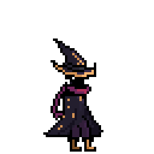
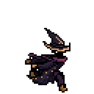

<p align="center">
  
</p>

<h1 align="center">LibreSprite AI MCP</h1>

Draw and animate pixel art with an AI agent in a real LibreSprite window. You can watch the edits, pause the agent, and undo its changes in the editor. The agent can also preview frames and export sprite sheets, GIFs, and APNGs.

**Source alpha.** This is an independent project, not an official LibreSprite release. There’s no public download yet, and stock LibreSprite can’t connect to the MCP server.

## Get started

### 1. Build the editor and server

Install Node.js 20+ and follow the native prerequisites for [Apple Silicon macOS](docs/building.md) or [Windows x64](docs/windows.md#building-from-source). On Windows, run the commands in the **MSYS2 UCRT64** shell. The full Linux editor workflow hasn’t been verified.

```sh
git clone https://github.com/maxsunc/libresprite-ai-mcp.git
cd libresprite-ai-mcp
npm ci
npm run build
bash scripts/build-libresprite.sh
```

### 2. Connect your AI client

```sh
npm run setup
```

Choose your client and an artwork folder. Start with copies, not your only originals. The wizard shows the configuration before writing anything. Reload your client after applying it and check that the **libresprite** server appears.

Use a client that supports **local MCP over stdio**; to see previews, your client and model also need to support MCP images. See the [setup guide](docs/setup.md) for Cursor, Claude, Codex, VS Code, Pi, and other clients.

### 3. Make your first sprite

Try this prompt:

> Use LibreSprite MCP to launch a new editor and connect to it. You can resume AI editing in that window. Draw a 16×16 slime, show me a preview, and save it as a new `.ase` file in my artwork folder. Don’t overwrite anything.

Agent editing starts paused. To take back control at any time, click **Pause** in the editor’s status bar. A pause set there can only be lifted in the window.

## Animation showcase

| Amalgamation | Mage stomp | Mage run — forward lean |
| --- | --- | --- |
|  |  |  |

See also: [skeleton mage staff slam](examples/animations/skeleton-mage-staff-slam.gif), made with gpt-6.1-sol and the pixel-animation skill.

## Learn more

- [Live editing guide](docs/live-bridge.md) — tools, manual setup, and editing limits.
- [Pixel-animation skill](.agents/skills/pixel-animation/SKILL.md) — an optional workflow for key poses, timing, and review.
- [macOS review packaging](docs/packaging.md) and [Windows review packaging](docs/windows.md) — Windows packages are private-review only pending a licensing audit.
- [Changelog](CHANGELOG.md) · [Credits](CREDITS.md) · [License](LICENSE.md) · [Report an issue](https://github.com/maxsunc/libresprite-ai-mcp/issues)
